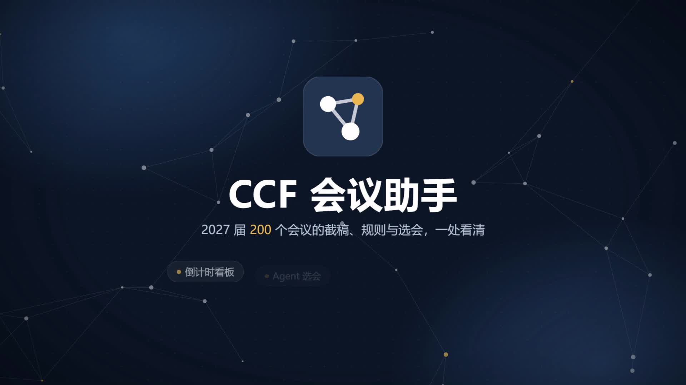

# CCF 会议助手

CCF 推荐会议 2027 届的问答与选会助手。用大白话问会议，或贴一段论文摘要让它推荐投哪里。

[在线使用](https://m-24rjgc.github.io/ccf2027/) · [倒计时看板](https://m-24rjgc.github.io/ccf2027/dashboard.html) · [观看宣传片（62 秒）](https://m-24rjgc.github.io/ccf2027/media/ccf2027-promo.mp4)

[](https://m-24rjgc.github.io/ccf2027/media/ccf2027-promo.mp4)

**2026-10-27 更新：大幅加强网络安全与隐私保护。** 本版集中加固共享及个人 API Key 的传输、临时会话、恶意内容渲染、看板导出和发布流程。详见下方「安全与隐私」。

- **知识库是 LLM Wiki，不是 RAG**：200 个会议的数据先整理成互相链接的 Markdown 页面（`wiki/`），每个字段都标了来源（知识补全 / 官网核查 / 缺口重查）。回答时读页面、沿链接多跳，不去翻原始材料。
- **日期由代码算**：截稿时间统一为北京时间，剩余天数、当前轮次按访问时刻实时计算，不让模型心算。
- **联网核查由访客开启**：默认仅查知识库；勾选联网后，可用 DeepSeek Search / Fetch 核对会议官网。查到的新信息进「待审」区，人审过才入库。
- **关系图**：会议 · 方向 · 概念 · 同期同地，可点可看；回答后高亮推理路径。
- **倒计时看板**（`dashboard.html`）：按状态 / 方向 / CCF 等级 / 新人条款筛选，未来 16 周截稿分布图可按周筛选；点任意一行看详情（精确到秒的倒计时、摘要截止、各轮时间线、往届录用率），可导出 `.ics` 日历（提前 3 天、1 天提醒）。筛选状态写在地址栏 `#` 后面，可直接分享链接，不写浏览器存储。

前端部署在 GitHub Pages，默认使用作者提供的免费共享服务，无需访客填写 API Key，受每日额度限制。共享模型及搜索密钥存于后端秘密环境变量。也可在「设置」中切换为个人 API 模式：个人 Key 仅保留在当前页面内存中，刷新或关闭页面后清除。

## 安全与隐私

| 对象 | 保护措施 |
|---|---|
| 作者提供免费服务的 API Key | 只用于后端向固定官方 HTTPS 接口认证，不下发给浏览器，不加入模型提示词、Git 仓库或前端构建；上游跳转被拒绝，错误响应不透传密钥 |
| 访客自己的 API Key | 仅在个人模式的页面内存中保存；浏览器直接请求对应服务商的官方 HTTPS 接口，不发送给本站共享后端，不写入 localStorage、sessionStorage 或 URL |
| 问题、摘要与回答 | 本站业务数据库不保存问答正文，也没有对话查询接口；当前对话仅在页面内存中保留，刷新或关闭即清除，并清理旧版浏览器缓存中的会话与 Key |
| 联网核查 | 默认关闭；开启后仅用会议名、年份和公开规则词构造检索词，抓取限于已知官网与搜索发现的官方页面，不把整段摘要或对话提交给搜索接口 |
| 用量与后台 | 记录每日次数、token、并发及短期限流计数；来源地址使用每日变化的带密钥哈希，不保存原始 IP。管理接口校验站点所有者身份，限额更新另有来源和版本校验 |
| 页面与导出 | Markdown 严格过滤危险 HTML 和外部图片；脚本本地托管并校验完整性，配合内容安全策略与禁止发送 Referer；看板转义外部字段并防止日历内容注入，离线版脚本采用哈希白名单 |
| 发布检查 | 每次更新检查密钥误提交、依赖已知漏洞及隐私回归；GitHub Pages 必须在安全检查通过后发布，工作流依赖固定到提交版本 |

**数据处理边界：** 回答问题必须将问题和近期对话发送给 Step；开启联网后，DeepSeek 会收到公开检索词与待抓取的网址。模型服务及 GitHub / 托管平台按各自政策处理请求，可能保留访问或运行元数据；本项目不能承诺第三方零留存，也不能防止已被控制的设备或浏览器扩展读取页面。个人模式的 Key 对当前浏览器自身可见。不要在问题中填写密码或 API Key；已公开或贴入聊天的 Key 应撤销并更换。

待审内容只有主动复制、导出或手动提交 Issue 才会离开当前页面。看板筛选条件可保存在地址栏片段 `#` 中用于分享，不包含问答历史，但可能出现在浏览器历史中。宣传片仅展示公开演示问题，不收集访客会话。

## 目录

```
allconf.json            ccfddl 原始数据
extract.py              → base_2027.json（2027 届 200 个会议，时间折北京时间）
enrich/ verify/ newbie/ recheck/   各核查波次的结果（recheck/ 也接收待审合并）
build_xlsx.py           → merged.json + CCF2027会议投稿规划表.xlsx
build_html.py           → site/js/dashboard-data.js + CCF2027投稿倒计时看板.html（离线单文件版）
                          看板页面本身是手写的 site/dashboard.html / dashboard.css / js/dashboard.js
fetch_accept.py         → accept_rates.json（ccfddl 往届录用率，MIT）
concepts.json           概念页内容（AoE、ARR、互惠审稿…）
build_wiki.py           → wiki/（LLM Wiki）+ site/data/wiki.json
apply_pending.py        待审修改 → recheck/ + changelog.jsonl
make_recheck.py         信息缺口 → recheck_slices/（本地核查队列）
wiki/SCHEMA.md          知识库维护规则（唯一手写的 wiki 文件）
site/                   网站（GitHub Pages 根目录）
backend/                问答服务、流式响应、持久化用量与并发限制
promo/                  宣传片源文件与公开示例录制脚本
site/media/             已发布的 62 秒宣传片与预览图
tests/                  隐私、看板与录制安全测试（node --test tests/*.test.mjs）
```

## 更新数据

```bash
python extract.py          # ccfddl 数据有更新时
python fetch_accept.py     # 刷新往届录用率（需要 git）
python build_xlsx.py
python build_html.py
python build_wiki.py       # 生成 wiki/ 与 site/data/wiki.json，并输出体检报告 wiki/LINT.md
```

依赖：Python 3.10+，`pip install openpyxl pyyaml`。

## 待审修改入库

网站「待审」页 → 采纳 → 导出 `pending.json`（或「提交 GitHub Issue」后把 JSON 存成文件），然后：

```bash
python apply_pending.py pending.json --dry-run   # 先预览
python apply_pending.py pending.json
python build_xlsx.py && python build_wiki.py
```

字段有白名单、取值有校验、必须带出处 URL，不合格的会被跳过并报告。

## 本地预览

```bash
python -m http.server 8765 --bind localhost --directory site
```

用 **http://localhost:8765** 打开（不要用 127.0.0.1：StepFun 接口对这个来源返回的跨域头有问题，浏览器会报 Failed to fetch）。

## 部署到 GitHub Pages

1. 建仓库并推送（`.env` 已在 `.gitignore` 里）。
2. 仓库 Settings → Pages → Source 选 **GitHub Actions**。
3. 推送到 `main` 后 `.github/workflows/pages.yml` 先运行安全检查，再自动发布 `site/`。

## 模型与接口

| 用途 | 接口 | 说明 |
|---|---|---|
| 推理 | OpenAI 兼容 Chat Completions，默认 StepFun `step-5-preview` | `reasoning_effort` 按问题自动路由：单会议事实查询 low，一般问题 medium，推荐/对比/贴摘要 high；也可手动指定 |
| 联网 | DeepSeek `POST /v1/tools/search`、`/v1/tools/fetch` | 需访客主动勾选；共享模式使用后端 Key，个人模式使用访客自己的 Key |

默认模式由后端执行知识库工具及上述接口调用，仅接受问题、近期对话、推理等级与联网开关，不接受访客指定上游接口或模型。个人 API 模式保留浏览器直连。

服务端运行变量：`STEP_API_KEY`、`DEEPSEEK_API_KEY`、`CLIENT_HASH_SECRET`、`ALLOWED_ORIGINS`。密钥使用托管平台的秘密变量配置，不参与前端构建。`SERVICE_ENABLED=false` 可暂停共享问答。

共享额度默认按 UTC 日重置：每个来源每天 10 问、每分钟 2 问、全站每天 50 问、最多 3 个并发且同一来源最多 1 个。另设每天 200 次模型调用、100 次搜索/抓取和 200 万 token 预算；模型调用前预留输入及最大输出额度，成功返回用量后退回余额，失败或取消时保留预留额度。相关上限可通过 `backend/lib/service.mjs` 中列出的环境变量调整。

问题及近期对话会发送给模型服务，不写入本站业务数据库。数据库保留每日汇总、模型调用用量、限流计数、并发占用及管理身份和限额配置，不保存问答正文。前端的待审数据由各访客自行审核和导出。

## 宣传片

[播放最新宣传片](https://m-24rjgc.github.io/ccf2027/media/ccf2027-promo.mp4)（62 秒 · 1920×1080 · 30fps · H.264/AAC · 约 26 MB）。内容包括倒计时看板、Agent 选会、知识库引用关系、Wiki、新人条款、到场要求和投稿上限。演示数据以录制时的知识库为准，当前日期与剩余天数请查看网站。

`promo/` 保存制作脚本；原始截图和运行记录被 Git 忽略，下面的流程可重新生成。录制使用固定公开示例和共享服务额度，不读取 `.env` 或个人 API Key。

```bash
python -m http.server 8765 --bind localhost --directory site   # 另开一个终端
node promo/capture.mjs         # 截取真实界面 → promo/assets/
node promo/capture-agent.mjs   # 录制固定公开示例，消耗共享服务额度
python promo/facts.py          # 知识库规模 + 运行记录 → promo/out/facts.js
python promo/music.py          # 合成配乐 → promo/out/music.wav
node promo/render.mjs          # 逐帧渲染 → promo/ccf2027-promo.mp4
```

需要 Edge 或 Chrome、numpy/scipy，以及 ffmpeg（PATH 里的、`FFMPEG=` 指定的，或 `pip install imageio-ffmpeg`）。在浏览器里直接打开 `promo/stage.html` 可实时预览，加 `?t=12` 跳到某一秒。

## 数据来源与许可

- 会议截稿、往届录用率：[ccfddl/ccf-deadlines](https://github.com/ccfddl/ccf-deadlines)（[MIT 许可](site/CCFDDL-LICENSE.txt)）
- 参会要求、投稿上限、新人条款：各会议官网，出处 URL 见每个会议页
- ARR 日期：[aclrollingreview.org/dates](https://aclrollingreview.org/dates)
